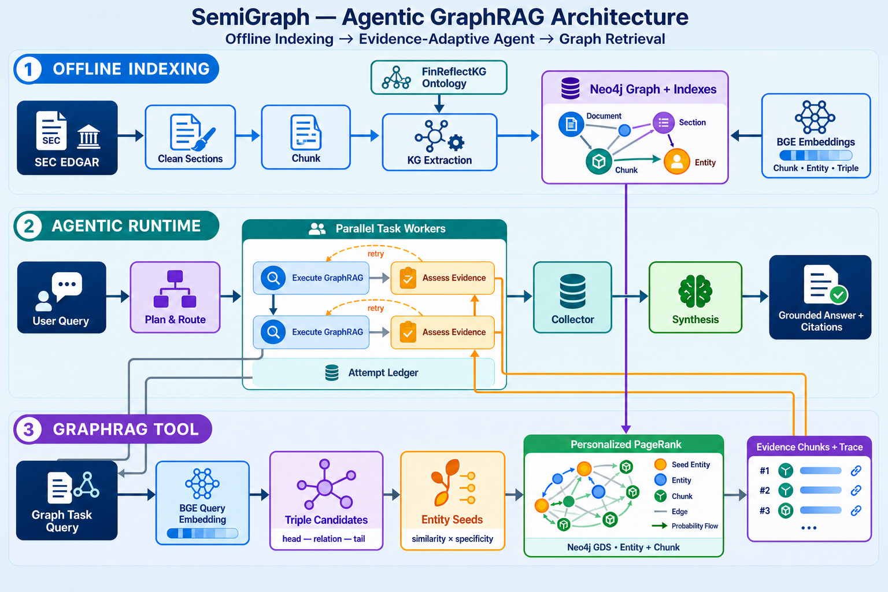

<div align="center">

<h1>SemiGraph</h1>

<p><strong>Agentic GraphRAG for evidence-grounded semiconductor analysis</strong></p>

<p>A KMUTNB senior thesis comparing Vector RAG, GraphRAG, and evidence-adaptive Agents on the same semiconductor filing questions.</p>

<p>
  <a href="#research-positioning"></a>
  <a href="#evaluation"></a>
  <a href="#quick-start"></a>
  <a href="#architecture"></a>
  <a href="#architecture"></a>
  <a href="#quick-start"></a>
</p>

<p>
  <a href="#quick-start">Quick Start</a> ·
  <a href="#evaluation">Results</a> ·
  <a href="#architecture">Architecture</a> ·
  <a href="benchmark/README.md">Benchmark data</a>
</p>

</div>

---

## Overview

SemiGraph tests whether graph retrieval and an evidence-adaptive Agent help
answer multi-hop questions over semiconductor company disclosures. It combines
source-linked filing chunks, an ontology-based knowledge graph, Vector and
Graph Search, and a traceable Agent workflow. The active retrieval tools are
**Vector Search** and **Graph Search**.

### Highlights

- **Evidence you can trace:** answers cite filing chunks; retrieval and Agent
  steps can be inspected instead of being hidden behind one answer.
- **Two retrieval backbones:** vector similarity finds relevant text, while
  graph retrieval uses entity relationships and Personalized PageRank.
- **Evidence-adaptive Agent:** plans independent evidence needs, assesses
  retrieved chunks, and retries within a bounded budget.
- **Controlled comparison:** four configurations separate the effect of Graph
  retrieval from the effect of Agent control.



> **Research prototype.** This project evaluates retrieval and answer quality;
> it is not an investment recommendation system. Saved benchmark results do not
> guarantee that one configuration wins on every question.

## Quick Start

To inspect saved results without running a new evaluation, install the project
and open the four-way comparison UI:

```bash
conda create -n senior_project python=3.10
conda activate senior_project
pip install -e .
streamlit run Demo/comparison_app.py
```

Choose **Benchmark (7690) → Frozen replay** to inspect previously saved runs
without a Neo4j or LLM call. For a Live run, configure the selected database
and an LLM API key using [Developer Setup](#developer-setup).

## Research Positioning

Financial questions often require evidence that is split across filings and
connected through entities such as companies, products, suppliers, risks, and
geographies. Vector similarity is useful for finding locally relevant text, but
it does not explicitly model those relationships.

SemiGraph therefore evaluates two independent variables: the retrieval
backbone (Vector or Graph) and the presence of an evidence-adaptive Agent. The
main comparison uses a controlled `2 × 2` ablation:

| Configuration | Retrieval | Controller | Purpose |
|---|---|---|---|
| **Vector-only RAG** | Filing chunks by vector similarity | Single retrieval pass | Establish the semantic-retrieval baseline |
| **Graph-only RAG** | Knowledge Graph and Personalized PageRank | Single graph retrieval pass | Isolate the value of graph retrieval |
| **Agentic Vector RAG** | Vector retrieval only | Plan, assess evidence, and retry | Isolate the value of the Agent controller |
| **Agentic GraphRAG** | Knowledge Graph and Personalized PageRank | Plan, assess evidence, and retry | Evaluate the complete project configuration |

This separation matters: Graph retrieval and Agent control are different
variables. SemiGraph evaluates them independently instead of treating every
gain as a generic “GraphRAG improvement.”

## Architecture

The diagram above shows the SEC-to-GraphRAG path. The evaluation compares
Vector/Graph retrieval with and without an Agent controller.

### 1. Offline indexing

```text
SEC EDGAR 10-K
  → clean and extract Item 1 / Item 1A / Item 7
  → token-aware chunks
  → one structured LLM extraction per chunk
  → Pydantic + ontology validation
  → Neo4j knowledge graph with source provenance
  → chunk, entity, and relationship-triple embeddings
  → synonymy, node specificity, and reusable GDS projection
```

The graph schema is defined only in
[`src/semigraph/ontology/schema.py`](src/semigraph/ontology/schema.py). It
adopts the FinReflectKG ontology and adds provenance nodes such as `Document`,
`Section`, and `Chunk`. Extracted relationships retain their filing, ticker,
fiscal year, section, and source-chunk lineage.

### 2. GraphRAG retrieval

The Graph Search Tool closes the path from a natural-language query back to
evidence chunks:

```text
query
  → BGE query embedding
  → query-to-triple candidates
  → head/tail entity seeds
  → Personalized PageRank over Entity + Chunk topology
  → ranked evidence chunks + stage-level trace
```

Neo4j GDS runs `gds.pageRank.stream` from query-specific `sourceNodes` over a
reusable projection. The projection connects domain entities, filing chunks,
`MENTIONS`, and `SYNONYM_OF` edges, so PPR can rank passages as part of the
graph walk instead of mapping entities back to text only after traversal.

The effective Graph profile—including seed mode, PPR topology, seed weighting,
candidate budget, optional triple filtering, and reranking—is configured in
[`config/default.yaml`](config/default.yaml). Retrieval traces record the
parameters that actually ran; benchmark claims should use those traces rather
than infer settings from an old report.

### 3. Evidence-adaptive Agent

The current LangGraph runtime is:

```text
User Query
  → PlanRoute
  → bounded parallel Task Workers
       Execute retrieval → Assess evidence
               ↑              │
               └── retry ─────┘
  → deterministic Collector
  → one grounded Synthesis
  → Answer + Citations
```

`PlanRoute` turns the question into evidence requirements and retrieval
actions. Each isolated worker records every attempt in an append-only
`Attempt Ledger`. `Assess` may accept, stop, or propose a validated next action
when evidence is missing. The Collector restores plan order before Synthesis,
so parallel completion order does not silently change the final context.

Every retrieval adapter returns the same contract:

```text
{ chunks, trace }
```

An `AttemptRecord` binds the requested action, retrieval status, raw chunks,
retrieval trace, and assessment. This makes tool choice, retries, accepted
evidence, and final citations inspectable without exposing hidden
chain-of-thought.

## Retrieval Tools

| Tool | Evidence source | Current role |
|---|---|---|
| **Graph Search** | Neo4j entities, relationships, chunks, and GDS PPR | Primary multi-hop relational retrieval |
| **Vector Search** | Neo4j chunk vector index | Semantic baseline and controlled Agent comparison |

Financial Search, News Search, and their ETL code have been retired. Historical
datasets, evaluation results, and PostgreSQL snapshots/infrastructure remain
for reference; the current application does not query PostgreSQL.

## Evaluation

SemiGraph evaluates retrieval and answer quality as separate layers:

- **Retrieval:** Chunk Hit, Recall, evidence-group coverage, `Answerable@K`,
  MRR, latency, and retrieval-call budget.
- **Agent:** requirement coverage, retry behavior, evidence gain, duplicate
  retrieval, tool calls, and stop reasons.
- **Answer:** human-reviewed answer points, faithfulness, factual correctness,
  and citation validity.
- **Controlled ablations:** the same corpus, model, graph, top-k/context
  budget, and evaluation questions are held fixed whenever possible.

The repository contains FinReflectKG/SOX controlled datasets, retrieval-only
results, Agent results, and human-review artifacts. A controlled corpus result
is not presented as a full production end-to-end result.

### Saved four-way comparison: first 50 SOX questions

The `human_verify_2` full-answer runs compare the same 50 query IDs. Retrieval
Hit means at least one expected chunk was found; Answer Hit means at least one
answer point passed the recorded review checklist. Neither means the whole
answer was correct.

| Configuration | Retrieval Hit | Answer Hit | Fully correct |
|---|---:|---:|---:|
| Vector-only RAG | 32/50 | 24/50 | 1/50 |
| Graph-only RAG | 42/50 | 28/50 | 4/50 |
| Agentic Vector RAG | 45/50 | 35/50 | 3/50 |
| Agentic GraphRAG | 48/50 | 35/50 | 3/50 |

These are saved runs, not a guarantee that Graph or Agent will win on every
question. The Agent configurations may retrieve more chunks through retries,
so their retrieval scores are not a fixed-top-k comparison with the single-pass
configurations. The review rubric, per-point scores, latency, and separate
`human_verify_2_fast` runs are documented in
[`benchmark/README.md`](benchmark/README.md).

See [`benchmark/README.md`](benchmark/README.md) for dataset contracts and the
reproducible commands, output locations, and metric caveats.

## Project Layout

```text
src/semigraph/
├── ontology/      # FinReflectKG-based schema and validated graph models
├── offline/       # SEC ingest, preprocessing, chunking, extraction, storage
├── online/        # graph, vector, rerank, and PPR retrieval
├── agents/        # current Agent v1.5 and LangGraph dev entrypoint
├── agent/         # retained Agent implementation for the older evaluator/Demo
├── benchmark/     # benchmark adapters and normalization
├── config.py      # cached YAML + .env configuration boundary
└── connections.py # Neo4j, embedding, and LLM factories

config/default.yaml    # operational parameters; .env contains secrets
Demo/                  # four-way Streamlit comparison UI
scripts/               # ingestion, indexing, traces, and smoke tests
eval_scripts/          # controlled Vector/Graph/Agent evaluation harnesses
benchmark/             # versioned datasets and result artifacts
docs/                  # public guides, review UI, and architecture image
tests/e2e/             # browser checks with fake backend; opt-in live smoke
```

## Developer Setup

### Advisor handoff on Windows (Docker-first)

The advisor package uses prebuilt private GHCR images, Docker named volumes,
and a source bind mount. It does not require a local Python/Conda setup or the
legacy unit-test workflow.

```powershell
.\handoff.ps1 setup
.\handoff.ps1 start
.\handoff.ps1 smoke
```

See the complete Thai guide in
[`docs/system_manual_advisor_handoff.md`](docs/system_manual_advisor_handoff.md).

The remaining instructions in this README describe the developer-native setup.

### Prerequisites

- Python 3.10 or newer
- Docker Compose
- Neo4j 5.26 Community with APOC and Graph Data Science plugins
- An API key for the LLM provider selected in `config/default.yaml`

Create the environment and install the package using the commands in
[Quick Start](#quick-start).

Create a project-root `.env` for the core SEC + GraphRAG path:

```env
OPENROUTER_API_KEY=...

NEO4J_URI=bolt://localhost:7687
NEO4J_USER=neo4j
NEO4J_PASSWORD=...

EDGAR_EMAIL=your@email.com
EDGAR_ORGANIZATION=Your Organization
```

Secrets are read through `Config`; application code should not read environment
variables directly. Vector/Graph retrieval does not require Finnhub or PostgreSQL.

Start the GraphRAG database and verify connectivity:

```bash
docker compose up -d neo4j
python scripts/test_neo4j_connection.py
```

Run unit tests without the optional browser suite:

```bash
pytest tests/ --ignore=tests/e2e -v
```

### Open the four-way comparison UI

Run the `streamlit` command from [Quick Start](#quick-start).

Select **Benchmark (7690)** for the controlled corpus or **Production (7687)**
for free-form questions. A Live run sends one question to all four
configurations, displays their answers, total latency, retrieval trace, and
clickable citations, and can call the LLM multiple times per Agent. The UI
marks a panel as timed out after 120 seconds; this display cutoff does **not**
cancel an already-running backend call. The selected Neo4j database must be
running for Live mode; the default `docker compose up -d neo4j` starts only
the Production database.

**Frozen replay** is available on Benchmark only. It opens previously saved
first-50 results without calling Neo4j or the LLM. Some saved results contain
chunk IDs but not chunk text, so replay cannot show source text that was never
recorded. Replay is for inspecting prior runs, not measuring a new run.

Browser checks use a fake backend by default and therefore do not incur LLM
costs:

```bash
pip install -e '.[e2e]'
python -m playwright install chromium
pytest tests/test_demo_ui.py tests/test_demo_backend.py tests/e2e/test_comparison_ui.py -q
```

The separate, paid live smoke test is opt-in; see
[`tests/e2e/README.md`](tests/e2e/README.md) before running it.

## Common Workflows

### Onboard one 10-K ticker

The pilot downloads filings, preprocesses sections, extracts the KG, builds
embeddings, computes graph features, verifies Neo4j, and records metrics:

```bash
python scripts/pilot.py --ticker KLAC --workers 8
```

The implemented ingestion path is 10-K-centric. Foreign issuers that file
20-F require a separate section parser before using the same pipeline safely.

### Manage the reusable PPR projection

```bash
python scripts/manage_ppr_projection.py status
python scripts/manage_ppr_projection.py prepare
```

Refresh the projection after the stored graph changes:

```bash
python scripts/manage_ppr_projection.py refresh
```

### Trace one Agent query

```bash
python scripts/run_agent_trace.py \
  "How exposed is AMD to TSMC supply risk?" \
  --show-citations \
  --show-retrieval-traces
```

### Compare retrieval backbones

```bash
python eval_scripts/evaluate_new_agent.py \
  --tool vector \
  --version_name vector_v1 \
  --mode retrieve_only
```

Run the same command with `graph`, `agent_vector`, `agent_graph`,
`deepagent_vector`, or `deepagent_graph` to compare retrieval configurations.
DeepAgent is an additional Agent architecture, not one of the original four
configurations. All active evaluation entry points live in `eval_scripts/`.

## Design Boundaries

- SemiGraph is a research system for evidence retrieval and synthesis, not a
  trading engine or buy/sell recommender.
- A graph relationship is retrieved evidence, not proof of causality.
- HippoRAG-style triple linking and PPR are foundations. SemiGraph's project
  contribution is their integration with domain constraints, evidence-adaptive
  Agent control, provenance, and controlled Vector/Graph evaluation.
- Tunable runtime values belong in `config/default.yaml`; secrets belong in
  `.env`.
- Generated corpora, local database volumes, credentials, and temporary Agent
  artifacts must not be committed.

## Documentation

- [Benchmark datasets and reproducibility](benchmark/README.md)
- [Advisor handoff guide](docs/system_manual_advisor_handoff.md)
- [Browser test guide](tests/e2e/README.md)
- [RunPod benchmark environment](docs/benchmark_runpod_environment.md)

## License

No license has been declared yet. Until one is added, the repository remains
all rights reserved by its authors.
