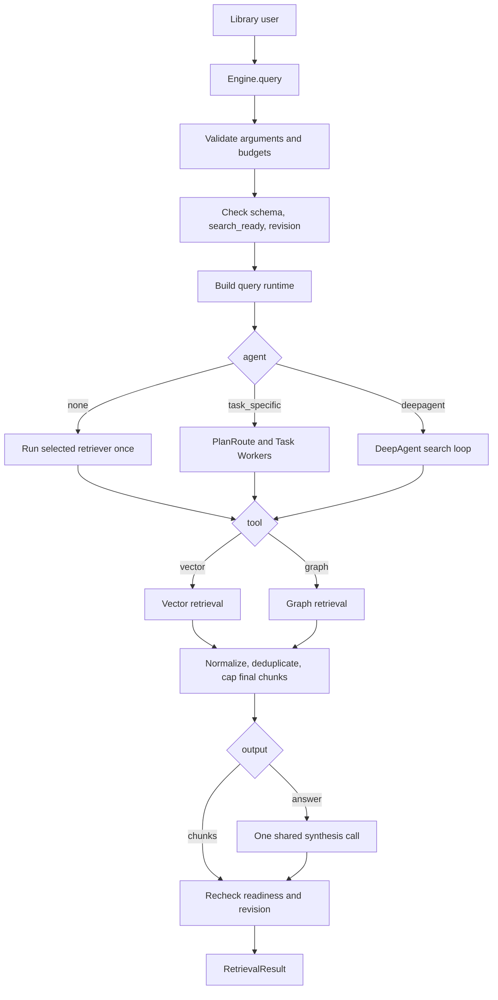
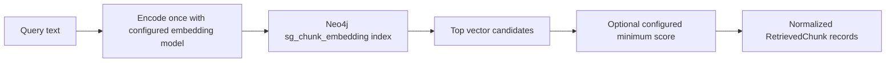
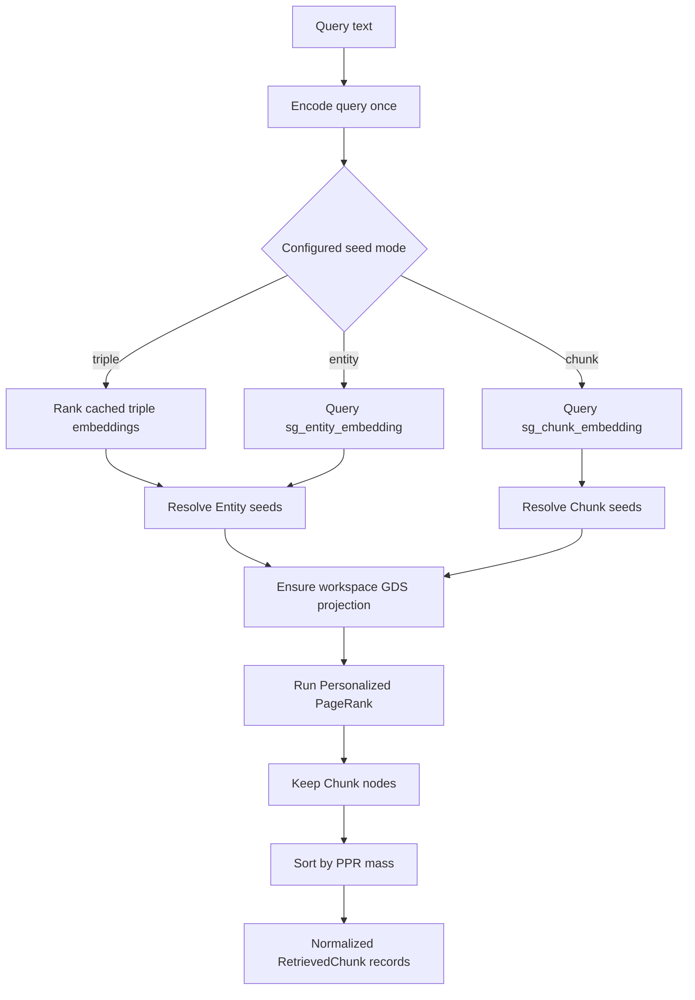
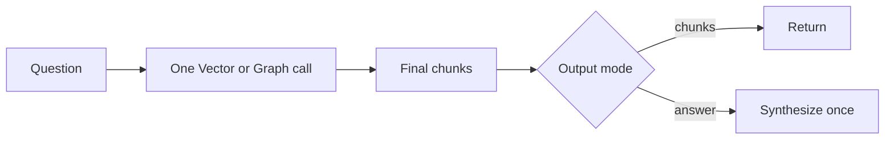
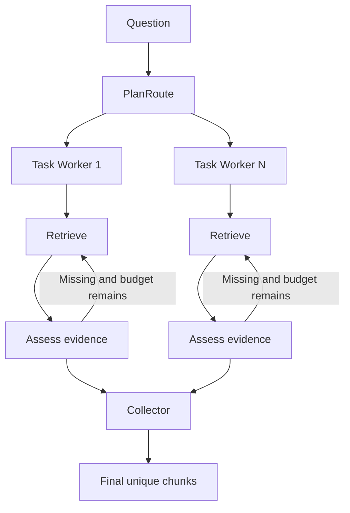
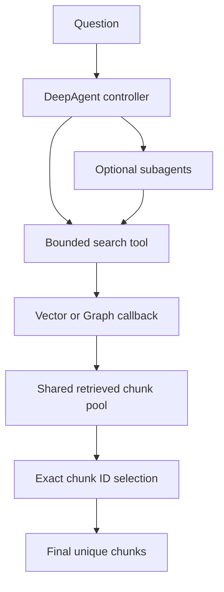
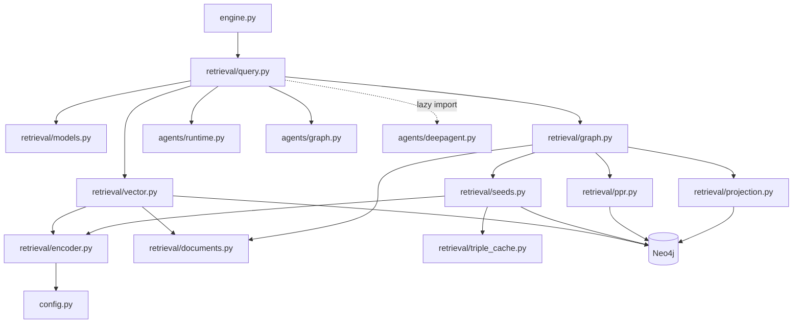

# Spec 03 — Retrieval kernels and friendly query API

Status: implemented and verified on 2026-10-25. All 69 SDK tests passed. The 12-mode RAGTEST API smoke and isolated fresh-ingestion/revision/projection-restart smoke passed; evidence below.

## Goal

Let a library user query a finalized SDK corpus through one method. The caller chooses Vector or Graph retrieval, direct or Agent control, and chunks or a grounded answer. The implementation remains isolated under `library/` and does not modify or import the original SemiGraph runtime.

This specification has two delivery slices:

- **03A — Retrieval kernels:** configured Vector Search, graph seed selection, Personalized PageRank, projection recovery, and normalized chunk results.
- **03B — Query facade:** `Engine.query()`, Task-specific and DeepAgent routing, optional synthesis, readiness checks, and one public result contract.

03A must pass direct Vector and Graph tests before 03B binds either kernel to an Agent.

## Public contract

```python
from semigraph_sdk import Engine

with Engine.from_config("knowledge/semigraph.yaml") as engine:
    result = engine.query(
        "ปั๊ม P7 ใช้วัสดุอะไร",
        tool="graph",           # vector | graph
        agent="task_specific",  # none | task_specific | deepagent
        output="chunks",        # chunks | answer
        top_k=10,
    )
```

```python
Engine.query(
    question: str,
    *,
    tool: Literal["vector", "graph"] = "vector",
    agent: Literal["none", "task_specific", "deepagent"] = "none",
    output: Literal["chunks", "answer"] = "chunks",
    top_k: int = 10,
) -> RetrievalResult
```

| Parameter | Meaning |
|---|---|
| `question` | Non-empty natural-language query |
| `tool` | Retrieval kernel used by every search in this call |
| `agent` | Direct single search or one of the bounded evidence controllers |
| `output` | Return final chunks only or synthesize one answer from those chunks |
| `top_k` | Maximum number of unique chunks in the final result |

The facade supports all 12 combinations: 2 tools × 3 controllers × 2 output modes.

`top_k` is the final evidence budget. It is separate from the number of chunks returned by each Agent search. The SDK rejects contradictory budgets before any LLM call. In particular, `top_k` must allow at least one final chunk per planned Task.

## Result contract

```python
RetrievalResult(
    status="ok",              # ok | no_evidence
    question="...",
    tool="graph",
    agent="task_specific",
    output="chunks",
    chunks=[...],
    answer=None,
    corpus_revision=3,
    trace={...},
)
```

Each final chunk has a stable shape:

```python
RetrievedChunk(
    chunk_id="sgc_...",
    text="...",
    rank=1,
    entities=[...],
    assertions=[...],
    matches=[
        RetrievalMatch(
            query="ปั๊ม P7 วัสดุ",
            tool="graph",
            rank=2,
            score=0.031,
            score_kind="ppr",
        )
    ],
)
```

`matches` preserves where an Agent found the chunk. Vector cosine similarity and PPR mass retain distinct `score_kind` values. The facade never treats them as one calibrated score. The final `rank` records direct retriever order or Agent evidence-selection order.

`status="no_evidence"` means retrieval completed successfully but selected no evidence. Invalid configuration, unavailable databases, missing indexes, GDS failures, LLM failures, and corpus revision races raise typed exceptions instead.

## End-to-end flow



Rules:

1. `agent="none"` executes exactly one retrieval call.
2. Agent modes may search several times but remain within configured budgets.
3. Agent modes always finish evidence collection before answer generation.
4. `output="chunks"` never invokes synthesis.
5. `output="answer"` invokes the shared synthesis function exactly once.
6. The answer may cite only chunk IDs present in `result.chunks`.

## Vector retrieval flow



Vector Search reuses the original vector-query principle, not its financial assumptions. It excludes ticker reranking, fiscal-year reranking, financial query expansion, global config, and per-call driver creation.

The query encoder must use the same model, revision, dimension, and normalization settings stored in SDK metadata. A mismatch fails before retrieval.

## Graph retrieval flow



Supported seed modes:

| Mode | Source | Use case |
|---|---|---|
| `triple` | `triple_embedding` stored on verified assertions | Default; retrieves through relation meaning |
| `entity` | `sg_entity_embedding` | Queries dominated by entity or concept names |
| `chunk` | `sg_chunk_embedding` | Starts diffusion from semantically similar passages |

`triple` is the proposed default because Stage 02 already creates evidence-grounded assertion embeddings. Graph retrieval returns `no_evidence` with `abort_reason="no_seeds"` when no valid seed exists. It never silently falls back to Vector Search.

Graph results report seeds, projection metadata, top PPR entities, and chunk PPR mass in the trace. PPR is graph diffusion, so the SDK must not fabricate a single graph path as provenance.

## Agent flows

### Direct



### Task-specific Agent



The runtime loads `ObservedRelation` rows ordered by assertion count. These relations are optional wording hints, not an ontology whitelist or evidence.

### DeepAgent



DeepAgent is imported only when selected. If its optional dependency is absent, the SDK returns an installation hint without affecting direct or Task-specific modes.

## Module dependency flow



Dependency direction is one-way. Low-level retrieval modules never import `Engine`, query facade, or Agent code. Agent copies know only retriever callbacks and never open Neo4j connections themselves.

## File responsibilities

| File | Responsibility | Must not do |
|---|---|---|
| `engine.py` | Own driver and lazy shared dependencies; expose `query()` | Contain Cypher, PPR, Agent prompts, or ranking rules |
| `config.py` | Validate immutable Vector, Graph, and Agent settings | Read original project config or hide invalid values |
| `retrieval/models.py` | Public result models, enums, score provenance, typed errors | Open DB connections or execute retrieval |
| `retrieval/documents.py` | Hydrate selected chunk text and stored entity/assertion provenance | Rank candidates or transfer embedding vectors |
| `retrieval/encoder.py` | Reuse one lazy embedding model and validate output dimension | Select graph seeds or know Agent modes |
| `retrieval/vector.py` | Query `sg_chunk_embedding`; return normalized direct matches | Apply financial reranking or create drivers |
| `retrieval/seeds.py` | Select triple, entity, or chunk seeds from one query vector | Run PPR or synthesize answers |
| `retrieval/triple_cache.py` | Load and cache assertion vectors for one finalized revision | Keep stale revisions or mutate stored vectors |
| `retrieval/ppr.py` | Resolve seed node IDs, run GDS PageRank, map scores to chunks/entities | Build projections or use a fixed relation catalog |
| `retrieval/projection.py` | Inspect, rebuild, and recover the SDK GDS projection | Rank evidence or increment corpus revision |
| `retrieval/graph.py` | Coordinate seed selection, projection, PPR, and graph trace | Call an LLM or silently use Vector fallback |
| `retrieval/query.py` | Validate readiness; route direct/Agent/output; normalize final result | Implement Vector/PPR math or import DeepAgent eagerly |
| `agents/runtime.py` | Carry explicit LLM, retriever callbacks, relation hints, and Agent budgets | Read environment variables or connect to Neo4j |
| `agents/graph.py` | Execute copied Task-specific control flow | Own database or embedding configuration |
| `agents/deepagent.py` | Execute copied DeepAgent search control flow | Select a different tool than the caller requested |
| `tests/test_retrieval.py` | Test kernels, cache, projection, readiness, and failures | Call paid LLM APIs |
| `tests/test_query.py` | Test all 12 public combinations and result normalization | Depend on production secrets |

## Configuration

```yaml
retrieval:
  per_search_k: 10
  max_top_k: 100
  max_top_k: 100

  vector:
    min_score: null

  graph:
    seed_mode: triple
    seed_k: 10
    min_seed_score: null
    damping: 0.5
    max_iterations: 20
    top_k_entities_in_trace: 20

  agent:
    max_planned_tasks: 3
    max_attempts_per_task: 2
    max_parallel_tasks: 2
    max_relation_hints: 8
```

All config models are frozen Pydantic models with `extra="forbid"`. Unknown keys fail during config loading. No retrieval module reads environment variables directly.

`min_score` and `min_seed_score` default to `null`. Similarity thresholds depend on the embedding model, language, and corpus. The SDK does not claim one universal relevance threshold.

## Readiness and revision consistency

Before retrieval, the query facade must:

1. Verify database ownership and schema compatibility.
2. Verify required vector indexes are online.
3. Require `search_ready=true` and `corpus_revision > 0`.
4. Read and retain the starting corpus revision.
5. Ensure the GDS projection only when Graph retrieval is selected.

After all retrieval and optional synthesis, it must read readiness and revision again. It raises `CorpusChangedError` if ingestion started or the revision changed. This prevents one Agent run from mixing evidence from different corpus revisions.

## Triple cache lifecycle

Triple vectors cannot use one Neo4j relationship vector index across arbitrary Free Ontology relationship types without changing the Stage 02 storage model. Version 1 therefore uses a process-local read-only cache.

The cache identity is:

```text
workspace_id
+ database name
+ corpus_revision
+ embedding fingerprint
```

Requirements:

- Serialize cold loading with a lock.
- Share one immutable vector matrix across warm queries.
- Remove the previous revision for the same workspace when a new revision loads.
- Never reuse a cache entry when model settings or corpus revision differ.
- Never cache Neo4j passwords or LLM secrets.
- An empty assertion set is a valid cached result.

## Error contract

| Error | Meaning |
|---|---|
| `InvalidQueryError` | Empty question, invalid mode, or invalid `top_k` |
| `RetrievalConfigError` | Contradictory budgets or unsupported retrieval setting |
| `CorpusNotReadyError` | No finalized ingestion revision is searchable |
| `RetrievalBackendError` | Neo4j, vector index, projection, or GDS execution failed |
| `LLMNotConfiguredError` | Agent or answer mode requires an absent LLM |
| `LLMExecutionError` | Planning, assessment, or synthesis call failed |
| `OptionalDependencyError` | Selected DeepAgent or local embedding backend is not installed |
| `CorpusChangedError` | Readiness or corpus revision changed during the query |

Errors retain the failing stage and original exception type without exposing secrets. They are never converted into successful empty results.

## Maintainability requirements

1. **Isolation:** all new source stays under `library/`. It never imports `semigraph.*` from the original runtime.
2. **One public entry point:** library users call `Engine.query()`. Lower-level kernels remain testable internal APIs.
3. **Explicit dependencies:** driver, encoder, LLM, relation hints, config, and projection name enter through constructors or function arguments. No module globals hold project config.
4. **Strict boundaries:** Vector, seeds, PPR, Agents, and synthesis remain separate modules with one responsibility each.
5. **Stable public models:** public result fields are typed. Mode-specific diagnostics stay inside `trace` so internal stages can evolve without breaking callers.
6. **Score honesty:** every score includes its kind and source query. Code never compares PPR mass with cosine similarity.
7. **Typed failures:** callers can distinguish invalid input, unavailable corpus, optional dependency, backend failure, and revision races.
8. **No silent behavior:** no automatic tool switching, implicit query expansion, hidden retry, or domain-specific reranking.
9. **Lazy optional imports:** direct and Task-specific calls work without importing DeepAgent.
10. **Copy provenance:** copied algorithm fragments record their original file and source hash in `library/docs/copied-sources.json`.
11. **Unit-test seams:** encoder, retriever, LLM, and DB session behavior can use deterministic fakes without network access.
12. **One synthesis path:** every Answer mode uses the existing shared synthesis function after final evidence selection.

## Performance requirements

1. **Reuse one Neo4j driver per Engine.** Retrieval modules receive that driver and never create one per query.
2. **Load embedding model lazily once per Engine.** Warm queries reuse it. A lock protects model calls when backend thread safety is unknown.
3. **Encode each retrieval query once per kernel call.** Graph seed selection reuses the same query vector.
4. **Use Neo4j vector indexes.** Vector and entity retrieval never scan all Chunk or Entity nodes in Python.
5. **Reuse GDS projection.** Graph queries rebuild it only when missing or when ingestion creates a new revision.
6. **Cache triple vectors by revision.** Warm Graph queries do not reload all triple embeddings.
7. **Evict stale cache revisions.** Memory must not grow once per ingestion forever.
8. **Bound every list.** Seed count, per-search chunks, PPR entity trace, final chunks, planned Tasks, retries, and parallel workers have validated limits.
9. **Keep PPR inside GDS.** Python receives only ranked rows and selected metadata, not the entire projected graph.
10. **Do not copy embedding vectors into traces.** Traces retain IDs, ranks, scores, counts, settings, and timings only.
11. **Bound Agent searches.** Maximum searches are `max_planned_tasks × max_attempts_per_task`.
12. **Deduplicate final chunks by ID.** Repeated Agent matches add provenance to `matches`; they do not duplicate full chunk text.

No fixed latency SLA belongs in the contract because hardware, corpus size, embedding backend, Neo4j resources, and LLM provider vary. Tests enforce structural performance properties instead:

- A second query does not reload the embedding model.
- A warm Graph query does not reload the same triple cache.
- A warm Graph query does not recreate an existing projection.
- One direct query performs one retrieval call.
- Retrieve Only performs zero synthesis calls.
- Agent searches never exceed their configured budget.
- Cache keeps at most the active revision for the configured workspace.

Live smoke reports cold and warm latency separately without claiming benchmark superiority.

## Reuse boundary

Copy and patch only the necessary dependency closure from the original retrieval modules.

Preserve:

- Vector index query semantics.
- Triple, entity, and chunk seed concepts.
- Seed resolution.
- Personalized PageRank execution.
- Chunk-node ranking by PPR mass.

Remove:

- Original global config, model, and driver access.
- Fixed financial relationship lists.
- Ticker and fiscal-year metadata assumptions.
- Financial query expansion.
- Cross-encoder and metadata reranking in version 1.
- Fixed synonym relationship behavior.
- LLM triple filtering in version 1.
- Implicit fallback between tools.

Generic relation types discovered by Stage 02 participate through the SDK projection. `ObservedRelation` supplies optional Agent wording hints and never restricts graph traversal.

## Verification plan

### Unit and contract tests

- Validate argument enums, budgets, readiness, and typed failures.
- Verify Vector query uses `sg_chunk_embedding` and configured dimension.
- Verify all three graph seed modes.
- Verify triple cache keys and revision eviction.
- Verify projection reuse, restart recovery, and concurrent ensure behavior.
- Verify no-seed Graph retrieval returns diagnostic `no_evidence` without fallback.
- Verify score kinds remain distinct.
- Verify Retrieve Only never calls synthesis.
- Verify Answer mode calls synthesis exactly once.
- Verify answer citations are a subset of final chunk IDs.
- Verify all 12 tool/controller/output combinations with deterministic dependencies.
- Verify missing DeepAgent dependency does not break direct imports.
- Verify revision change during execution raises `CorpusChangedError`.

### Live Neo4j smoke

Use a clean disposable Neo4j database with APOC and GDS. Keep the user's RAGTEST corpus read-only:

1. Ingest chunks containing a relation absent from the old ontology, such as `USES_MATERIAL`.
2. Confirm Vector retrieval returns stored chunk text and cosine score metadata.
3. Confirm triple seeds include the new relation.
4. Confirm PPR traverses the new relation and returns Chunk nodes.
5. Drop the in-memory projection, rerun Graph retrieval, and confirm recovery.
6. Ingest another chunk, confirm revision increases, and confirm stale triple cache is not reused.
7. Restart Neo4j and confirm Graph retrieval restores the projection.

Agent integration tests use scripted LLMs. Paid-provider calls are optional integration evidence and are reported separately.

### Completed verification on 2026-10-25

- `pytest library/tests -q`: 69 passed, including all 12 public mode combinations, a real Task-specific facade flow with a scripted LLM, query validation, typed readiness/revision failures, seed modes, PPR ranking, triple-cache revision replacement, dynamic relationship projection, projection reuse/rebuild/race recovery, and existing Agent-copy tests.
- Read-only RAGTEST facade smoke at Bolt `7695` passed all 12 combinations against the live corpus. Each returned two chunks. Scripted local LLMs drove Task-specific, DeepAgent, and synthesis paths; chunks output made zero synthesis calls, answer output made one, and citations were valid.
- Read-only live queries on RAGTEST at Bolt `7695` returned the two existing chunks through Vector and Graph. Graph triple seeds traversed the existing `PREVENTS` and `USES` assertions; entity and chunk seed modes also returned both chunks.
- A repeated Graph query reused the cached triple matrix. Dropping the SDK-owned in-memory projection and querying again recreated it successfully.
- RAGTEST remained `search_ready=true`, revision `1`, with 2 chunks, 5 entities and 2 assertions. No corpus rows or workspace config changed. Fresh-relation ingestion and container restart were not run against this user corpus.
- An isolated Neo4j `2025.04-community` smoke used the real SDK setup/ingest/query pipeline with deterministic injected extractor and 8-dimensional embedder. It ingested a fresh `USES_MATERIAL` relation, retrieved its chunk with Vector, selected that relation as a Graph triple seed, and returned its chunk through GDS PPR.
- A second chunk advanced the corpus revision from 1 to 2. The query after ingestion missed the old triple cache and loaded revision 2. Dropping the in-memory projection caused the next Graph query to rebuild it. After restarting Neo4j, the persisted corpus remained ready at revision 2, the GDS projection was absent, and `Engine.query()` recreated it and returned the `USES_MATERIAL` evidence.
- The disposable container, data volume, config, and local test credentials were removed. RAGTEST remained read-only during this smoke. No paid LLM or external embedding model was used in the disposable run.
- Unit cache tests verify a new corpus revision replaces the prior triple cache. Agent and answer contract tests use deterministic fakes; this verification made no paid LLM calls.

## Done when

- All 12 public combinations return one stable result shape.
- Direct Vector and Graph use the finalized SDK corpus and configured embedding identity.
- Free Ontology relationships participate in triple seeding and PPR (verified with `USES_MATERIAL` on isolated Neo4j).
- Retrieve Only never synthesizes.
- Full Answer cites only returned chunks and synthesizes once.
- Query refuses unready, incompatible, or changing corpus state.
- Warm queries reuse driver, model, cache, and projection.
- All work stays isolated under `library/`; original project behavior remains unchanged.
